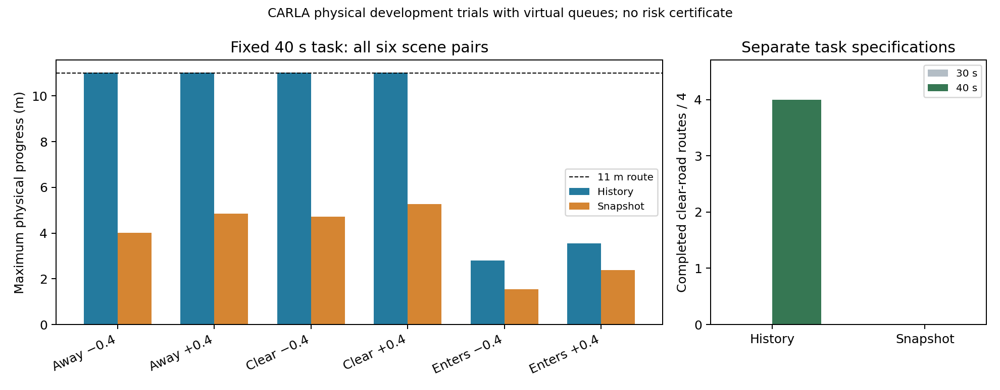

# 条件证据有效期在完整路线中产生收益：固定40秒开发任务

sheng完成12个预登记回合，history在四个道路已清空场景完成4/4路线，snapshot为0/4。另两个行人进入道路后停止场景，两方法均未完成，不能把停车算路线成功。全12回合无记录到的碰撞、源/状态采样漏覆、动作包络漏覆、过期放行或准入/实际控制重建错误。**这是虚拟网络与原子模拟执行器下的实际车辆物理开发结果，不是部署风险认证。**

| 场景 | history最大前进（米） | snapshot最大前进（米） | history / snapshot完成 |
|---|---:|---:|---:|
| 行人离开道路，x=-.4 | 11.011198 | 4.022371 | 是 / 否 |
| 行人离开道路，x=+.4 | 11.011198 | 4.854310 | 是 / 否 |
| 道路清空且保持，x=-.4 | 11.011198 | 4.724018 | 是 / 否 |
| 道路清空且保持，x=+.4 | 11.011198 | 5.270284 | 是 / 否 |
| 行人进入道路后停止，x=-.4 | 2.791063 | 1.545716 | 否 / 否 |
| 行人进入道路后停止，x=+.4 | 3.553723 | 2.381507 | 否 / 否 |

全部六场景的完成数是history 4/6、snapshot 0/6；主要终点为上表四个清空场景。未做随机总体抽样，4/4不是普遍成功率，也不提供显著性/风险置信结论。两策略在同信息源报文、源编译费用与运动/几何契约下比较；由于本车轨迹不同，后续真实回波与CPU费用不逐帧相同。这是配对场景的实际闭环，而不是同一轨迹上预设动作的影子收益。

history通过最近至多7次部分回波约束收紧当前速度范围；snapshot只用当前观测及全局5m/s最坏范围。当前history保留相同径向证明作为后备，增加条件分离前缀，500ms封顶。获准动作必须在**执行边界**满足 `now+300ms≤source_epoch+prefix`，并把当前整车与未来运动/后备包络放进源证据查询区域。source epoch不因收到新指令而刷新。当前ROI/登记体积/目标运动/本车连续域与制动契约成立时才有条件保证。[数学与可信度边界](evidence_expiry_answer_20261011.md)给出具体推导。

本批9,960行、4,800源；12个完整制动段150ms确认，2,374个中断制动段单列。无物理域终态拒绝。仅50ms采样及回调核验，不能证明真实连续时间、未执行后备状态的普遍制动保证、未知目标漏检或域外分布。道路目标停止仍有限动作分离，不保证证据结束后任何其他参与者都不会撞到驻车。所有回合/停车/失败均保留。

四个history清空回合均31.10秒首次到达，各619个go后到达目标，没有中断制动。达到目标后的等待、末端制动与过期lease也在日志中；这些阶段的`admission_denials`不能算作不必要停车。snapshot在清空场景有250–287个中断制动段，任务期间进度受反复制动限制。没有进一步调控制器或源参数追求成功；需要强同信息历史观察器/安全控制基线，才能判断算法创新而非已知历史信息价值。

## 实验规范与时间预算

原[30秒批次](actuator_admission_result_20261011.md)两方法均路线零成功。标称参照六回合31.10秒到达，候选40秒在参照之前固定，资格38.5秒截止带1.5秒预指定任务裕度。新40秒任务在捕获前独立登记[0947a7b2](https://github.com/boboxxx/mobi/commit/0947a7b26428eefac2af793f24e89dd0b85da1c5)，freeze `b25229a05c6f24684376db7fa928c7f598879149a79f6fe4593b8e2d2ea51aa8`。只增加任务时长/采样数量，model.py与30秒父批字节一致。它不是原任务的盲测结果，原失败未覆盖、不补抽、不持续研究循环。

Audi A2默认物理/手动一挡、继电目标.5m/s，域.75m/s；行人真实运动。源10Hz、控制/执行20Hz，固定50ms虚拟感知+实测源/接收/控制/执行CPU，两个20Mbps/20ms虚拟无线FIFO。CARLA synchronous tick暂停时准入/输入视为原子，平台render/log/control RPC费用单独记录。**没有实测无线、wallclock实时、Windows原生watchdog或WCET保证。** 当前只含固定RSU/背景、已登记单行人及低速车辆；没有未知目标、外部遮挡者或高速车流验证。

全原始数据无损归档337,747,328字节、18,488文件，包含点云、源/控制报文、实际控制、审计真值和全部日志。恢复后以冻结analyze独立重建；跨主机所有整数、前缀及决定一致，4个最大速度浮点末位各差1.11e−16，原值未改；逐文件验证在publication receipts保存。自有CARLA PID83492按路径/PID/启动时间停止，owned对象全部清零、世界恢复异步。

[全部结果与原始归档](../results/actuator_route_40s_20261011)、[冻结协议与代码](../experiments/actuator_route_40s_20261011)、[复现与完整校验](../experiments/actuator_admission_audit_20261011/REPRODUCE.md)。部分回波历史与执行端截止具有可执行的路线价值；可信度仍是登记/传感/运动/后备/时钟前提下的条件结论。当前收益不自动构成MobiCom 2027新颖性或真实风险认证。[近邻阅读](selective_expiry_reading_20261011.md)明确选择后覆盖与闭环分布问题。
