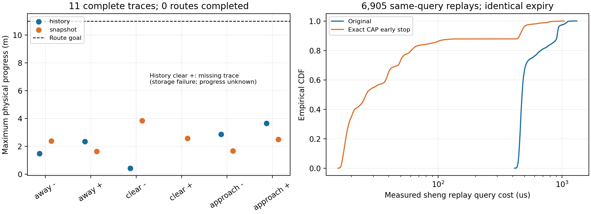

# 不完整观测的证据有效期：动态闭环开发结果

本次在 **sheng（Windows CARLA + Ubuntu WSL）**完成了固定计划的有限开发实验、原始数据保全、两主机审计和算法费用回放。结论是：**目前还不能称为“可信且不过度保守”的完整驾驶方案。** 历史观测可以支持更长的条件性前缀，但本批两种策略的路线完成数均为零。该负结果保留，不能用以前的影子查询许可增益替代任务收益。

## 科学问题与假设

可信有效期必须从源观测时刻起计算：对与部分观测一致的状态集合，在明确运动契约内，证明整个动作包络在一个连续前缀内与目标可达集分离。不是根据重建误差或平均预测准确度猜测TTL；源时刻不能在接收、解码、缓存时重置。查询时还必须支付证据年龄和处理费用，并覆盖动作持续时间。

这里的条件包括已登记单个行人的体积、姿态界、可靠外参/本车里程计、目标速度与速度变化模量。XYZ部分回波参与推断；目标ID、语义标签、真实位置和速度仅参与审计。它不覆盖未知目标数量、额外动态遮挡或未经限定的运动。缺观测或历史集合不一致时拒绝，不能当成“没有障碍物”。

历史法使用7帧区间的精确消元和方向分离证据；对照使用同信息报文中最新位置盒的距离及5m/s各向同性可达球，不额外叠加加速度。历史法亦保留同一径向证据，因此未收费的数学证明不会因为方向离散而弱于自己的径向备份。两者都属于已有集合观察和可达性工具，不能将组合本身宣称为新理论。原[冻结协议](../experiments/closed_loop_motion_20261011/PROTOCOL.md)、[源/输入哈希](../experiments/closed_loop_motion_20261011/freeze.json)在获取数据前固定。

## 实际任务与结果

真实Audi A2物理、手动1档；目标速度0.5m/s，域上限0.75m/s。车辆从道路坐标−8m出发，目标中心到达+3m；每回合30s尝试加1.5s制动尾段。三类行人运动各两个位置、两策略交替顺序，共12项计划。查询球半径2.5m、动作300ms、证据500ms封顶。传输是20Mbps/20ms的FIFO模型，处理和控制RPC费用实测；**这是带费用的物理协同仿真，不是实测无线或wall-clock实时证明。** 配对世界不会保证相同传感输入，ego位置本身会影响遮挡。

完整记录11回合，共6,930个控制采样和3,300份源观测。另1回合closed_07在WSL根盘满时持久化失败；其零字节轨迹、部分回波/报文与原失败日志全部保留，不填补真值、不重跑。恢复只完成之前未尝试的08..11，[恢复协议](../experiments/closed_loop_recovery_20261011/PROTOCOL.md)单独事先登记。迁移/服务重启可能影响费用，不能声称IID或同样的硬件时间条件。

| 回合 | 方法 | 场景 | 最大实际进展/m | 已选动作数 | 费用超支采样数 | 终态拒绝 |
|---|---|---|---:|---:|---:|---|
|00|history|离开道路|1.481|99|5|是|
|01|snapshot|离开道路|2.376|223|2|是|
|02|snapshot|离开道路|1.632|122|3|是|
|03|history|离开道路|2.350|177|1|是|
|04|history|持续清空|0.427|41|8|是|
|05|snapshot|持续清空|3.845|286|4|是|
|06|snapshot|持续清空|2.576|240|2|是|
|07|history|持续清空|未知|未知|未知|存储失败|
|08|history|接近后占道|2.865|302|1|是|
|09|snapshot|接近后占道|1.676|327|0|否|
|10|snapshot|接近后占道|2.489|355|0|否|
|11|history|接近后占道|3.657|386|0|否|

**路线完成：history 0/6计划（5条完整轨迹），snapshot 0/6。** 道路持续清空/最终清空的7条完整轨迹均触发费用预算拒绝；不能把占道场景的合理停车与清空场景的低进展混为一谈，也不能凭未碰撞认为任务已经解决。

11条完整记录中，源中心/历史状态漏覆、策略重建不一致、按预留20ms时钟计算的过期许可、选中动作的采样本车包络漏覆均为0；全回合碰撞记录为0。**closed_07的碰撞和轨迹状态未知**，不进入零碰撞断言。50ms采样的目标速度模量核对未见违反，不等于连续时间证明；亦无独立回合风险认证。这是固定开发数据，不提供5%风险或一般道路安全证书。

## 为何仍然保守：证据链中的费用和动作

固定实现把解码、查询和控制RPC统一预留20ms，超支后永久拒绝。实际总费用有26个采样超支，其中6次已经发出继续行驶指令。事后用真实总费用重新计算，这6次都仍满足本次证据截止和本车球包络；首次超支时的时限余量约29–80ms。另有两次首次拒绝发生在已经不许可的制动指令上。具体证据在[费用诊断](../results/closed_loop_motion_20261011/timing_diagnostic_sheng.json)。

这证明“超过统一处理预算”与“证据确已过期”是不同事件。**实际RPC费用是在发指令后取得的；事后余量不能作为事前安全许可，也不能追溯性地修复原预算契约。** 新方案需在执行端验证截止，或为命令生效延迟提供独立成立的界，再将其与可证明的动作/制动包络一起纳入证据消费。不能单纯放宽预算以获得路线正结果。固定300ms动作与不均匀证据年龄还产生1,277次终态拒绝前的有效期拒绝；这是同一轨迹上的诊断计数，非独立试验或新增控制结果。

事后实现了一个答案完全不变的费用优化：[达到CAP立即停止](../experiments/closed_loop_audit_20261011/fast_expiry.py)。原答案是500ms封顶的多个证明之最大值，任何一个已达上限时后续计算不可能改善答案。sheng上所有6,905个有缓存的观测查询逐一核对，四次计算返回的整数有效期均一致；6,064个答案封顶。每案例各两次计时、交替测量顺序、没有挑选最快测量：

| sheng查询费用 | 原实现 | 等价优化 |
|---|---:|---:|
|平均/μs|563.413|92.018|
|中位数/μs|475.504|26.217|
|95分位/μs|932.697|485.275|
|测得最大值/μs|1,315.341|1,040.344|

平均约6.12倍提速，属于**事后计算回放**；不同于原物理捕获时测得的查询时间，不是WCET，不授予新的驾驶成功率或期限保证。当前冻结控制器没有改变；这项优化也不能解决RPC长尾、制动保证、源观测漏失或完整路线任务。

## 研究候选问题的收敛

较可辩护的问题是：**如何从不完整观测得到可被执行端正确消费的证据时限，使集合不确定性、证据年龄、计算与命令生效费用、动作及失效后制动共同决定可执行性，而不是各自叠加最坏预算。** 现有结果显示信息端的区间收紧有作用，也明确暴露动作消费端的保守性。它是待验证的研究命题，尚不能声称新算法全面优于强基线或达到投稿要求。

完整策略的校准还必须与开发数据分离。最新邻近论文的[选择后轨迹间距校准](https://arxiv.org/html/2608.26533v1)明确区分离线保证和未校准闭环；[交互规划的鲁棒校准](https://arxiv.org/html/2511.10586v1)需要对策略引起的分布变化给出条件。这两篇均为作者预印本，阅读范围、条件和本项目推断见[阅读记录](closed_loop_calibration_reading_20261011.md)，不是已复现的期刊认证。我们不会将旧影子查询、静止目标证书或本次11条开发轨迹迁移成动态闭环风险证书。

## 可复核性与数据保全

[sheng审计](../results/closed_loop_motion_20261011/analysis_sheng.json)与[本地审计](../results/closed_loop_motion_20261011/analysis_local.json)分别从原始文件恢复并核对epoch、FIFO、报文/回波哈希、历史与状态、动作费用、实际控制、完整回合指标。所有离散值一致；仅4个最大本车速度的浮点末位差异，均为1.11×10⁻¹⁶m/s，见[跨主机比较](../results/closed_loop_motion_20261011/cross_host.json)。整数前缀另由冻结单元的独立二分根和多边形极值测试核对；本回合物理审计仍复用了部分解码/坐标函数，不宣称全部软件独立实现。

全部原始文件分12个回合档案加元数据档案，合计163,959,392B；单文件均低于GitHub限制。[原始清单](../results/closed_loop_motion_20261011/raw_archives/raw_manifest.json)列出7,169个归档文件的哈希/长度，包括失败回合部分数据。派生combined的重复文件由原记录重建，不重复压缩、不虚构轨迹；其失败描述明确标为synthetic_failure_descriptor。存储迁移前后文件逐一校验，[迁移收据](../results/closed_loop_motion_20261011/relocation_receipt.json)保留。

两次CARLA自有服务均已按PID、路径和启动时间核对后停止：[首次停止](../results/closed_loop_motion_20261011/first_stopped_ownership.json)、[恢复批次停止](../results/closed_loop_motion_20261011/tail_stopped_ownership.json)。没有创建持续研究循环。完整复核命令见[REPRODUCE](../experiments/closed_loop_audit_20261011/REPRODUCE.md)。
