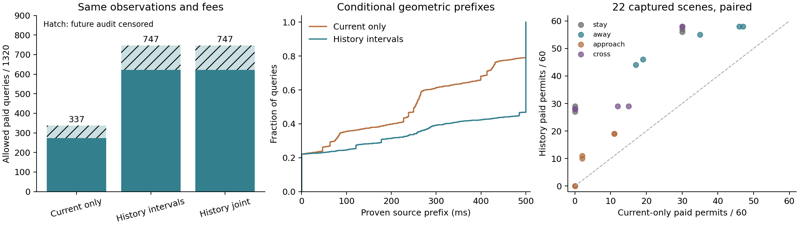

# 动态不完整观测：历史能延长条件有效期，关联表示本身无收益

在sheng完成新的固定开发批次：24个计划场景，22个完成，660份原始LiDAR观测，1320个配对查询。两个目标出生失败保留，不补抽。**同回波、同信息、同收费条件下，历史方法允许747个查询，当前观测方法允许337个；但尚未完成独立可信认证或实际ego闭环。**这是算法机制验证，不能写成项目或期刊实验全部完成。

## 算法与可信度来源

沿用原XYZ组件/未知yaw外包前端，运行时不使用目标ID、标签、真值中心、速度或运动控制。可见LiDAR回波仅覆盖物体部分表面；登记体积与传感器外参把它变成中心区间。此批只有已登记单行人、固定地图/背景/RSU，没有新增外部遮挡或未知目标。

最近至多7帧观测给源状态(p,v)施加约束：历史时间差d对应 L−Ad²/2 ≤ p−dv ≤ U+Ad²/2。速度范围5m/s、每轴加速度3m/s²。覆盖成立的历史会收紧速度范围，因此无需一直付出统一最坏5m/s运动球的保守性。缺失、空或不一致历史拒绝；不把没看到目标解释成道路空闲。

对固定查询球，未来最坏间距是源状态支持函数减去加速度余项。它是凹函数，严格正首末间距足以证明**整个连续前缀**分离。输出充分证明的源前缀τ，500ms封顶。接收使用条件为

    原始源年龄 + 已支付费用 + 300ms动作 ≤ τ。

所以日志中的`expiry_us`是包含动作的源前缀；动作开始期限是源时刻+τ−300ms，不能把500ms前缀称为500ms可启动TTL。查询球半径2.5m，目标球为登记三维半径。这是**历史位置集、运动范围、登记体积和查询包络都真实成立时**的充分保证；未知感知误差、漏检和域外运动尚未被独立校准。

## 捕获前排除了一个伪创新

完整(p,v)多边形与它的独立p/v区间外包，未来轴向支持在本模型中完全相同。原因是所有历史条带都形如p−dv、d≥0：最小p与最小v能够同时达到，最大p与最大v亦如此。**集合更小不意味着当前安全任务得到更紧的证明。**[解析证明](../experiments/joint_motion_expiry_20261011/THEORY_SUPPLEMENT.md)与150组精确历史测试在读取物理结果前已有此结论。

因此这批比较三者：当前观测snapshot、历史区间factorized、历史关联joint。后两者逐查询前缀完全一致，符合预期。历史方法相对当前观测的收益属于已有集合观察器机制；参考[KTH遮挡行人集合融合](https://people.kth.se/~kallej/papers/Situational_CTR2025_Narri.pdf)，不能直接宣称原创。原六篇近邻与实验借鉴继续见[文献笔记](transactions_expiry_reading_20261011.md)。

## 配对结果与费用

| 方法 | 仅计100ms年龄的允许查询 | 计费允许 / 1320 | 允许中未来审计范围不足 | 完整未来采样审计的允许查询 |
|---|---:|---:|---:|---:|
| 当前观测＋全速度范围 | 420 | 337（25.5%） | 64 | 273 |
| 历史独立区间 | 760 | 747（56.6%） | 125 | 622 |
| 历史关联多边形 | 760 | 747（56.6%） | 125 | 622 |

配对新增许可410个、丢失0个；22个完成场景中20个增加、2个持平。源前缀中位数从252.81ms增加至500ms封顶；封顶以外不作推断。它们是同场景重复查询，**不是1320个独立风险样本**。未来不足的查询单列，不能计作验证成功；不同方法的未删失分母也不同，不能直接当风险优势。

660源的当前中心、整段历史中心、源(p,v)均无采样审计漏覆；速度、差分加速度与倾斜检查无违反。完整未来采样审计的许可未发现球冲突。真值每50ms检查，**不能证明真实连续动力学边界、真实道路风险或未知分布覆盖**。

原始源频率均10Hz，使用时间最低100ms源年龄。实测采集费用中位63.61ms、P95 93.32ms；统一编译费用中位19.51ms、P95 29.26ms。共同编译费涵盖XYZ前端、三种参考推断、六次查询和报文编码，三者同付；这是同费用下的几何比较，不是各自部署最优实现的速度排名。另计20Mbps串行化、20ms传播、实测解码和20ms执行费用。实际计费源年龄中位123.96ms、P95 154.93ms。无线费用为固定模型，**不是实测无线或实时闭环**。

## 复核与执行边界

算法/参数/场景在捕获前冻结，预注册提交[3455493a](https://github.com/boboxxx/mobi/commit/3455493a665fdbe3a912ce4e44607bc43c44b883)，freeze SHA256为`a8fccef5f1ddac6ee06046977594bee39eb83e322f1390ad091e2e75f8637cc2`。全部冻结源未改；2个出生失败记录原样保存。WSL后台启动曾遇vsock失败，随后同一冻结脚本通过Windows SSH启动；记录保留。本批自有CARLA PID10304已按路径/PID/启动时间验证后停止，owned对象清零、世界恢复异步。没有建立持续研究循环。

sheng与本地数学测试均通过。独立条带消元不调用生产多边形算法，重算3960个前缀并核对660份回波/报文及费用，两端PASS。本地用sheng费用回放，所有整数范围、前缀、报文、决策和汇总一致。54个浮点审计距离末位不同，最大`9.313225746154785e-10`微米；原值未改，两份科学JSON**不逐字节相同**。

[冻结算法与协议](../experiments/joint_motion_expiry_20261011)、[独立审计/恢复/复现](../experiments/joint_motion_audit_20261011/REPRODUCE.md)、[结果](../results/joint_motion_expiry_20261011)已保存。24.87MB无损包含全部原始回波、报文、失败与sheng结果，恢复后核验1363文件；不重复提交158MB解压数据。详见export清单和跨主机receipt。

## 对候选问题的推进

本批给出一个可复核答案：**在明确且成立的感知/运动前提下，让真实历史收紧安全任务需要的运动范围，可以延长付费后仍可用的有效期；增加状态表示复杂度并不自动产生收益。**当前收益已超过静止目标或有限玩具模型，但不能把条件证明升级成一般可信认证。

项目尚缺：从独立数据认证这些感知/运动前提在所选用策略下的失效风险；新增外部遮挡、未知目标/运动突变的拒绝机制；动态ego闭环的完整路线成功与必要/不必要停车；同信息与实际处理/网络成本下的强近邻比较。这些应成为后续具体算法与实验，不能靠本批零采样漏覆代替，也不能把已有集合观察器包装成IEEE Transactions的新贡献。
