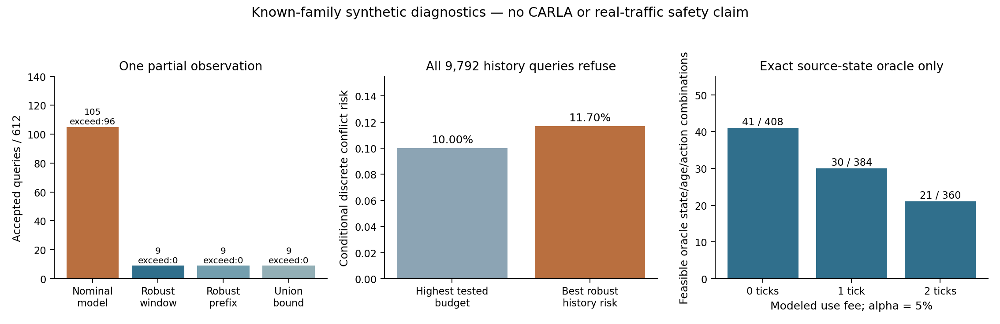

# IEEE Transactions 项目更新：观测可信度是有效期的瓶颈

本轮先检索并阅读类似论文，再在 sheng 完成两项预先固定的有限算法诊断。结论是**负的**：目前不能把“动作窗口/安全时间区间”作为本项目的新突破；在测试的宽观测与运动模型范围下，三次不完整观测仍不足以支持可信的动作许可。更有依据的候选问题应改为：**获取或推断什么安全相关信息，才能产生在使用费用之后仍可用的证据有效期？**这项推断/获取算法尚未完成，不能称项目已达到 IEEE Transactions 投稿水平。

[六篇核心论文的阅读、近邻与实验设计](transactions_expiry_reading_20261011.md)覆盖 TVT 语义检测、TCOM 部分可观测采样、V2X 集合融合、联合 belief、CP-SIPP 和 StochSIPP。FullPerception 仅摘要阅读，另有受限参照；各篇的全文/版本与未复现范围明确标注。TVT 暂作算法方向候选，TMC 的系统贡献仍需额外实验。没有把作者稿等同于最终发表版，也没有因目标改变而修改已冻结的 CARLA 结果。

## 第一项：单次观测与动作窗口

先固定代码及 [协议](../experiments/action_window_reference_20261011/PROTOCOL.md)，提交 [f0385194](https://github.com/boboxxx/mobi/commit/f0385194d6a7f106200bf9e2579ac92e7c9e02d8) 后运行。九个隐藏位置，三个粗观测类别与空观测，12个运动/观测模型，全程用精确有理数。风险是动作期间任一离散占据发生冲突的概率，包含首末时点，不是最终时点的错误率。共612个查询上下文、2448个独立模型/查询重建；这些是穷举的诊断查询，**不是612个独立交通回合**。

| 方法 | 允许查询 / 612 | 超过声明模型下对应预算的查询 |
|---|---:|---:|
| 单一名义模型 | 105 | 96 |
| 全模型动作窗口 | 9 | 0 |
| 源时刻锚定的单一期限前缀 | 9 | 0 |
| union bound | 9 | 0 |
| 只检查动作终点 | 9 | 0 |
| 任意可能路径均安全的支持集门槛 | 0 | 0 |

单一模型允许的查询中，最坏实际声明模型的风险最高约51.51%。这不是96次碰撞，而是96个查询的精确风险大于该查询的预算。较少拒绝不能据此算改进。

全模型动作窗口在1%、5%、10%预算下分别允许1/204、3/204、5/204。加入0、1、2个使用费用时间步，允许数分别为9/612、2/576、0/540；费用步为50ms，负到达年龄排除。它们是逻辑费用，不是实测无线或计算费用。**本批没有任何非前缀可用区间，也没有窗口法相对强基线的可用性优势。**单元测试构造的“中途冲突、终点安全”反例确实成立，但主扫描没有因此分开两种方法，不能拿反例充当整体性能提升。

36个风险/观测/动作配置的相同元数据二进制报文总计：区间3268B、bitmap3348B。差异很小，且许多允许集合为空；它不证明实际通信优势。两种解码器对全部可用年龄/费用组合逐一一致，接收时间加费用后仍使用原始源时刻。SHA256用于一致性检查，不证明传感器真实性或概率模型正确。

## 第二项：同一模型范围内增加三次观测

新的 [时序协议](../experiments/temporal_action_window_20261011/PROTOCOL.md) 在提交654233edd后运行。保持首批的运动参数、观测似然、风险预算和动作长度不变，加入采集时刻0、2、4的真实部分观测；穷举64种历史。每个模型分别按自己的似然更新后验。最新观测基线也得到传播至时刻4的正确先验，避免人为削弱基线。

共9792个查询上下文、39168个历史/模型/动作概率重建；最新观测与完整历史均允许 **0** 个查询。3672个选择风险分组全部没有选择动作，风险条件分母为空。因此“没有违反预算”是空选择下的结果，**没有新的非停滞或有用性保证**。

首批参考时刻为0，第二批为4，先验也随真实运动传播；两批的允许数不能直接解释为增加历史使性能变差。时序批次内的最新观测与完整历史对照才使用相同参考时刻与查询域。

独立审计另写概率递推，不复用生产代码的矩阵实现；核对每个模型下全部历史概率和为一，并复核所有窗口风险。全部历史与动作域中，最小的最坏模型风险是

    36421903800792881609 / 311304761728000000000
    = 11.699758...%

对应观测历史[1,2,2]、源年龄7步、动作长度1步；最坏模型是前进概率0.35、返回概率0.15、粗观测错误概率0.12。它仍大于最高测试预算10%。这给出了**固定动作、离散年龄范围、既定模型族、逐历史最坏模型风险语义下**的不可行性证据：这些概率是条件模型中的精确值，换一个更紧的数值求解器不会使任何已测试请求合法。它不证明所有传感器、驾驶动作、保证语义或真实道路都不可行。

## 事后解释：需要更有辨识力的信息

独立审计还增加了一个明确标为事后的 oracle 参照：只把源时刻4的真实位置提供给算法，运动模型范围及源年龄照旧；未来位置不提供，源时间也不重置。只枚举该时刻实际可能出现的0..7状态。

5%预算下，0、1、2步费用分别允许41/408、30/384、21/360个状态/年龄/动作组合。这不是历史实验的同一分母，也不是已实现传感器的成功率。它只能说明：在相同运动范围内，更多有辨识力的源信息可以改变可行性，首批全拒绝不能简单归因于动作本身绝不安全。

## 对候选算法的实际调整

继续给同一宽后验换 TTL 编码没有实验依据。下一实现应直接围绕动作能否被证明安全来处理不完整观测：保留多模态状态/意图假设，辨别哪些假设造成拒绝，选择能区分这些危险假设的额外视角或历史观测。只有真实新增的采集才能带来新源时刻；转发、重新计算和缓存不能续期。

保证语义必须先固定。**逐观测/逐模型风险**与**固定使用策略所选择回合的总体风险**不同。后者可以独立认证，但不能冒充每个当下观测的安全概率。当前CARLA证书属于前提明确的固定策略/回合统计保证；本轮有限模型诊断属于已知族内的精确条件概率。不能互相借用保证。

这是一项待验证的研究方向，不是创新已成立的结论。安全区间、集合观察器、Bayes滤波、首达概率、conformal和LTT均已有研究。期刊候选贡献需要落在安全任务驱动的观测推断/获取算法，以及**同风险、同信息/通信费用**下的可用有效期或驾驶任务改善。

后续物理实验应采用有/无遮挡行人、跨越/远离/停留的配对场景，独立开发/校准/认证/测试拆分，并提供未知目标、突变运动及执行负载变化的拒绝域。比较至少包括粗最坏可达集、集合观察器、已校准时序预测、紧凑cone、完整风险包络和通信/处理费用配平方案。报告完整路线成功、必要/不必要停车、源有效期与已支付费用后的余量、整回合风险；不再以5cm小进展代替完整任务。

## 可复核材料与执行范围

两项诊断在 Tailscale 名为sheng的 Windows DESKTOP-UGDDO8T及Ubuntu WSL执行；不是单独Linux集群。本轮**没有启动CARLA**，只使用已有Python环境运行有限精确模型验证。没有实测无线、连续碰撞保证、未知传感器校准或完整新驾驶实验。

两端科学JSON逐字节一致：

* 单次观测：`69153c78111f74f9df9a031941b96c0d7ce9adbe753f5826c6c4cb98f58e48af`
* 时序观测：`57320fa42c7144fbee7200e757d8df5328300a6cf7f253a2d0e3f746cd2d74fb`

[首批代码](../experiments/action_window_reference_20261011)、[时序代码](../experiments/temporal_action_window_20261011)、[独立审计与图代码](../experiments/transactions_diagnostic_20261011)、[首批全部结果](../results/action_window_reference_20261011)、[时序全部结果](../results/temporal_action_window_20261011)、[不可行性证据与oracle](../results/transactions_diagnostic_20261011)保留。运行耗时记录单独保存，只代表有理数参考实现的实测时长，不是生产算法时延或WCET。论文抓取来源、字节/hash和403失败后采用作者稿的记录也已保存，不上传第三方论文全文。

目前完成的是文献驱动的项目重构及两项可复现诊断。**尚未解决从未知/未校准的不完整观测获得可信且有用有效期的完整问题，也未完成IEEE Transactions论文的全部实验。**两个负结果与此前CARLA正/负结果一起保留，没有修改参数反复运行到出现正结果，没有建立持续研究循环。
